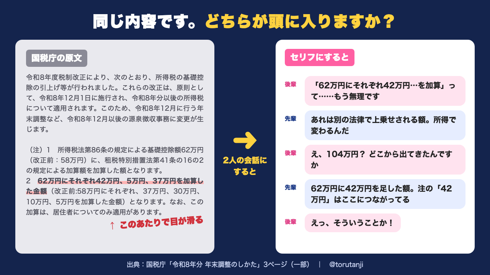

# serifu（セリフ）— 面倒な文章を、2人の掛け合いに変えるスキル

> **English:** A Claude Code skill that turns long, dense Japanese text (articles, URLs, PDFs) into a lively two-person dialogue, like a manga script, full of everyday analogies. It keeps the facts and numbers of the source exactly. Just say 「セリフで」 ("as dialogue"). The skill and its outputs are written in Japanese.

長くて難しい文章を、マンガのセリフのような2人の会話に変換する、Claude Code 用のスキルです。

「セリフで」と一言頼むだけで、プロの放送作家が書く台本のような、例え話たっぷりの掛け合いが返ってきます。

## こうなります



元の文章（国税庁「令和8年分 年末調整のしかた」3ページより一部）：

> （注）2　62万円にそれぞれ42万円、5万円、37万円を加算した金額（改正前:58万円にそれぞれ、37万円、30万円、10万円、5万円を加算した金額）となります。なお、この加算は、居住者についてのみ適用があります。

セリフにすると：

🟧**後輩**：「でも注に『62万円にそれぞれ42万円、5万円、37万円を加算』って……。もう無理です」

🟦**先輩**：「あれは、別の法律で上乗せされる額。ラーメンのトッピングみたいなもので、基本の62万円に、所得によって乗る量が変わるんだ」

🟧**後輩**：「全員同じじゃないんですね」

🟦**先輩**：「たとえば給与だけの人なら、表では年収665万5,556円以下の人が、今年と来年は104万円」

🟧**後輩**：「え、104万円？ どこから出てきたんですか」

🟦**先輩**：「さっきの62万円に、42万円を足した額。注の『42万円』は、ここにつながってるんだよ」

🟧**後輩**：「えっ、そういうことか！」

## こんなときに

- 上司から届いた、長くて難しいメール
- 会社の回覧文や、規程・マニュアル
- サービスの利用規約、保険の約款
- 年末調整や税金のお知らせ
- 専門用語だらけのニュースや技術記事

## 使い方（Claude Code）

1. Claude Code で、次の2つを実行して入れます。

   ```
   /plugin marketplace add toru-taaaaan/serifu-skill
   /plugin install serifu@serifu-skill
   ```

   プラグインを使わずに入れたいときは、ターミナルで次の2行でも入ります（`~/.claude/skills/serifu/` に置かれます）。

   ```
   git clone https://github.com/toru-taaaaan/serifu-skill.git
   mkdir -p ~/.claude/skills && cp -R serifu-skill/skills/serifu ~/.claude/skills/
   ```

2. Claude Code で、読みにくい文章やURLを渡して「セリフで」と頼みます。

   ```
   この文章をセリフで（ここに文章やURLを貼る）
   ```

使うたびに、何をどんな会話にしたかの短い記録がたまります（プラグインならプラグイン用のデータフォルダ、直接入れた場合はスキルの `references/past-runs/`）。次に使うときはその記録を読むので、使うほどあなた好みのテンポに近づきます。

## スキルを入れずに試す（ChatGPT・Claude など）

次の指示を貼るだけでも、同じ形を試せます。

```
あなたはプロの放送作家です。教養番組の台本を、友達同士の会話のテンポで書くつもりで、次の文章をマンガのような2人の掛け合いに直してください。
・登場人物は内容に合わせて決める（例：先輩と後輩、詳しい人と知らない人）
・例え話が命。難しい言葉が出たら、料理やコンビニなど身近なものに必ず置き換える
・形式は「名前：「セリフ」」で1行ずつ
・1人が3行以上しゃべり続けない。相手の相づちや質問で区切る
・流れは、つかみ→核心（例え話で）→「でもそれってさ」と深掘り→「つまりこういうことか」で締め
・聞き手は、読む人が引っかかりそうなところを遠慮なくツッコむ
・元の文章の事実と数字は正確に。書いていないことは足さない
・最後に区切り線を引いて、一言でまとめる

（ここに文章を貼る）
```

## 大事にしていること

- **説明会にしない**：「ポイントは3つあります」と始まる会話は、2人いても説明会です。例え話と本気の反応で進めます
- **元の資料に忠実に**：記事にない事実や数字は作りません
- **立場を取らない**：意見が分かれる話題では、事実だけを伝えます

## データの扱い（プライバシー）

- このスキルは、あなたが渡した文章やURLを、あなたの使っている Claude の中で会話に書き直すだけです。作者や他のサービスにデータを送ることはありません
- 個人情報を集めたり、保存したりしません
- 使った記録（何をどんな会話にしたかの短いメモ）は、ファイルを書ける環境でだけ、あなたのパソコンの中に残ります。外には出ません

**Privacy:** This skill only rewrites the text or URL you give it, inside your own Claude session. It sends no data to the author or any other service, and collects no personal data. Short usage notes are saved only on your own computer, where file writing is available.

## 作った人

丹治 統（[@torutanji](https://x.com/torutanji)）。非エンジニアです。紹介記事はnoteに書いています：[面倒な文章を10倍ラクに読む方法。AIに先輩と後輩の会話にさせるだけ](https://note.com/tourutanji/n/n859d5e3a45c9)

返事を日本語の声で読み上げるプラグイン「[yomiage](https://github.com/toru-taaaaan/yomiage)」も公開しています。セリフにした文章を、耳で聞けます。

## ライセンス

MIT License（`LICENSE` を参照）
